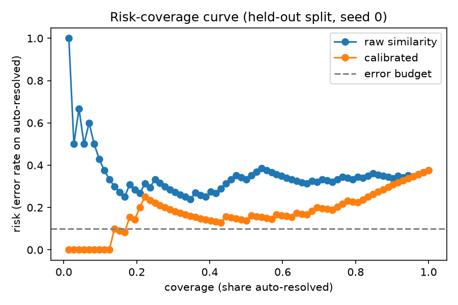
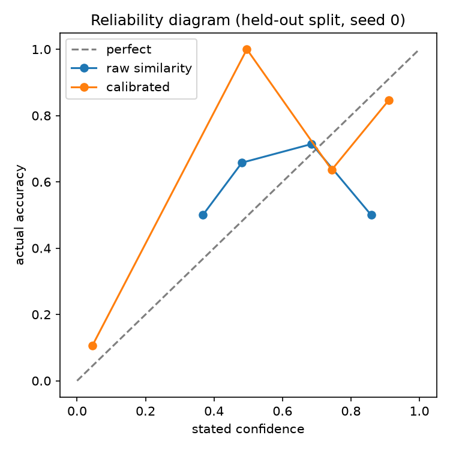

# deferral-curve

**A support bot that knows when to hand off to a human, and the measured cost of that decision.**

On 170 held-out support questions (English and Hinglish), a **guessed confidence threshold** let the bot answer
41% of questions on its own, but **23% of those answers were wrong**, more than twice a 10% error budget.
Replacing the guess with a **calibrated hand-off rule**, fitted on held-out data, gives a choice of two operating
points:

| Hand-off rule | Answered without a human | Error rate on those | ₹ per query |
|---|---|---|---|
| Guessed threshold (similarity ≥ 0.5) | 41% | **23%** | 14.99 |
| Calibrated, threshold at the measured 10% | 65% | 11% | 8.76 |
| Calibrated, **budget-safe** (deployed) | 28% | **8%** | 18.17 |
| Everything to a human | 0% | — | 25.00 |

Calibration error (ECE) drops from **0.134 to 0.017**: the bot's stated confidence now matches how often it is
right, most closely at the confident end where the hand-off decision is made.

**Live demo: [deferral-curve.onrender.com](https://deferral-curve.onrender.com)** (a fictional store, QuickKart;
try orders 4821, 5530, 6102). The free host may take up to a minute to wake up.

All numbers come from 5-fold cross-fitting with 3 seeds: every question is scored by a model and threshold fitted
on the *other* folds. Per-seed 95% bootstrap intervals are in [`artifacts/curve.json`](artifacts/curve.json).
For example, the budget-safe rule's error is 8% [0%, 19%], 7% [2%, 13%] and 9% [2%, 18%] across the 3 seeds.

---

## The curve

This is a **risk–coverage curve**, the standard way to evaluate *selective prediction*, where a model may decline
to answer ([Geifman & El-Yaniv, 2017](https://arxiv.org/abs/1705.08500)). Here it's applied to support deflection,
with a cost axis, and measured on a deployed system.



Moving right means the bot answers more questions on its own; moving up means more of those answers are wrong.
The guessed threshold sits far above the budget line. The calibrated curve stays lower at the same coverage.
The black markers are each rule's actual held-out result. Their thresholds were chosen separately inside each fold,
so they don't sit exactly on the pooled curve.



Raw similarity does rise with accuracy, but on the wrong scale: answers with a similarity near 0.5 were right about
68% of the time. Calibrated probabilities sit near the diagonal where most answers fall (≈ 0.75 → 73% right,
≈ 0.9 → 90% right). The middle bins hold only a few questions each, so their dots jump around. The numbers next to
each dot are question counts.

### Two ways to "hold" a 10% budget

- **Measured-error threshold:** the lowest threshold whose error on the calibration data is ≤ 10%. On new
  questions its error drifts to about 11–12%, because the threshold is tuned to the noise in that sample.
- **Budget-safe threshold (deployed):** the lowest threshold whose *95% upper bound* on the error (Wilson score) is
  ≤ 10%, in the spirit of Geifman & El-Yaniv's selective guaranteed risk. It held the budget on held-out questions
  in every seed, and it answers fewer questions in return. Holding a promise costs coverage, and this shows how much.

## Three outcomes, not two

Each answer gets a calibrated probability of being correct, and then one of:

- **Answered** — probability ≥ threshold
- **Answered, with a visible "talk to a human" option** — within 0.15 below the threshold
- **Handed to a human** — anything lower, or whenever the model is unavailable

---

## How it works

```
question ──► hybrid retrieval (BM25 + model2vec) ──┐
         └─► order tool, if an order number + intent ─┤
                                                      ▼
                     draft an answer from the context only (Groq, gpt-oss-120b)
                                                      ▼
                     verify: is every claim stated in the context?
                           └─ no → retry once with more context (max 4 model calls)
                                                      ▼
            6 signals ─► calibrator (logistic regression) ─► P(correct) ─► threshold ─► outcome
```

- **Retrieval:** BM25 ([bm25s](https://github.com/xhluca/bm25s)) for exact words, plus
  [model2vec](https://github.com/MinishLab/model2vec) static embeddings for meaning. Both are scaled and averaged.
  The embeddings are ~30 MB with no PyTorch, which is how everything fits in 512 MB.
- **Agent:** gather → act → verify → retry once, with a hard cap of 4 model calls per question enforced in code
  *before* each call. If the model fails or times out, it falls back to retrieval only and hands off.
- **Tools:** order status, refund status and cancel, on a simulated order database. Each question works on its
  own copy, so one visitor's cancel can't change another's answer.
- **Calibrator signals:** whether the verifier passed, whether the answer was "I don't know", whether a tool
  ran, the best meaning-match score, the gap to the second-best page, and the best word-match score.
- **Grading:** deterministic. Each question lists the facts a right answer must contain, in accepted English and
  Hinglish phrasings. A question that should go to a human is *never* counted as correctly auto-answered. There's
  no LLM judge.

### The test set

170 questions over a 31-page help centre, written for this project:
- **easy:** answerable from one page
- **near-miss:** look answerable but need a human, e.g. *"Can I use QuickKart Cash and a coupon together?"*,
  which no page states
- **unanswerable:** topics the help centre deliberately leaves out, like gift cards and warranty

### Serving

FastAPI in one Docker image on Render's free plan (512 MB RAM, 0.1 CPU), set up from
[`render.yaml`](render.yaml), which deploys only after GitHub CI passes:

- `/health` — liveness
- `/stats` — p50/p95 response time and peak memory
- `/metrics` — Prometheus

Each visitor gets 30 questions per day and the whole site 400, checked before any model call. Questions are not
stored.

## Reproduce

Nothing needs a GPU or a local setup. GitHub Actions does everything:

- **CI** (every push): lint, tests, retrieval recall@k, then re-scores the policy from the saved answers in
  [`evals/results.jsonl`](evals/results.jsonl)
- **Run agent on golden set** (manual): asks the model, caches every reply in
  [`evals/llm_cache.json`](evals/llm_cache.json), regrades and commits the results

Locally, `pip install -e ".[dev]"` and `python -m dc calibrate` reproduce every number above from the cache,
without an API key.

## Prior art

- [`huabeitech/agent-desk`](https://github.com/huabeitech/agent-desk), an open-source AI helpdesk with an
  answerability gate. It's the closest product; as of September 2026 it had no calibration and published no measured
  error or cost.
- [`facebookresearch/AbstentionBench`](https://github.com/facebookresearch/AbstentionBench) measures when LLMs
  should abstain across many datasets. This project applies the same question to one deployed support system,
  with a cost axis.

## Limitations

- **Test set, not traffic.** 170 self-written questions over a fictional store, not real customer tickets. The
  numbers show the method; they are not a claim about any production deployment, and they're not compared with
  industry deflection rates.
- **Near-miss questions are the weak spot.** Of 57 near-miss questions, the bot answered 42 wrongly, and the
  verifier passed many of them, so no signal flags them. These are the errors left above the threshold.
- **Grading was adjusted after reading answers.** Accepted phrasings were widened for 6 questions, and the 13
  order questions were made stricter (right tool *and* right facts). No question's expected outcome was changed.
  The evaluation also moved from split-half to 5-fold cross-fitting after split-half proved too small for the
  budget-safe bound. Both changes are in the git history.
- **Costs are assumptions:** ₹0.05 per model call and ₹25 per human ticket. Change them in
  [`dc/curve.py`](dc/curve.py) and the cost column moves.
- **The confidence intervals hold each seed's thresholds fixed,** so they don't include the uncertainty of
  choosing the threshold.
- **Free tiers throughout:** one model on Groq's free tier, a single region, a host that sleeps when idle.
  Retrieval uses an in-memory store instead of pgvector, and there is no Redis or Grafana dashboard; at this scale
  a disk cache and the `/metrics` endpoint do the job. Tools are rule-based and simulated, and the call budget is a
  small built-in counter rather than an external budget library.

## License

Apache 2.0
